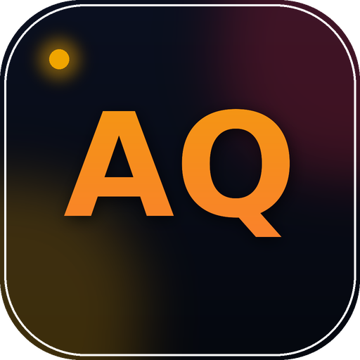

<div align="center">



# AQ Dev — عبدالقدوس الشيباني

### مطوّر تطبيقات · Flutter · Firebase · C# · ASP.NET · ذكاء اصطناعي محلي

**[🌐 زيارة الموقع](https://abdulquddus-dev.github.io/)**

<sub>Portfolio & app-showcase site for a Yemeni Flutter / Firebase / C# developer — built as a single-page app with dedicated, SEO-indexable pages per project.</sub>

<br/>


</div>

---

## 📖 نظرة عامة

موقع شخصي (Single Page Application) بُني بـ **HTML / CSS / JavaScript نقي بدون أي إطار عمل (Framework-free)**، ومربوط بـ **Firebase Firestore** لعرض إحصائيات حيّة (مشاهدات، تحميلات، تقييمات) لكل مشروع. الموقع يستضيف على GitHub Pages، ومصمَّم بالكامل RTL بالعربية.

الميزة التقنية الأهم: رغم أن الموقع SPA بالكامل، كل مشروع له **صفحة HTML ثابتة مستقلة وقابلة للفهرسة** تحت `/project/{slug}/` — بعنوان ووصف و JSON-LD خاص بها — بحيث يظهر كل تطبيق في نتائج بحث Google **كأنه موقع مستقل قائم بذاته**، رغم أنه في الأصل جزء من الموقع الشخصي.

---

## ✨ المزايا

| | |
|---|---|
| 🎨 **تصميم داكن فاخر** | ثيم Dark Mode بلمسة ذهبية/نبيذية، وخط عرض عربي مميز (El Messiri) للعناوين |
| 📱 **PWA قابل للتثبيت** | Manifest كامل + أيقونات بكل المقاسات + دعم maskable icon |
| 🔥 **إحصائيات حيّة** | مشاهدات وتحميلات وتقييمات حقيقية عبر Firebase Firestore (Realtime) |
| 🔎 **SEO احترافي** | صفحات مستقلة لكل مشروع + Sitemap + JSON-LD (Schema.org) + `llms.txt` لزواحف الذكاء الاصطناعي |
| 📰 **شريط أخبار تقني** | حركة مثل شرائط القنوات الإخبارية الحقيقية، بأيقونات SVG حقيقية للتقنيات المستخدمة |
| ⭐ **تقييمات ومشاركة** | نظام تقييمات بالنجوم، ومشاركة مباشرة عبر واتساب / تيليجرام / X |
| ⚡ **أداء عالٍ** | بدون أي إطار عمل، تحميل خطوط كسول (lazy font loading)، صور Lazy-loaded |

---

## 📱 المشاريع

| المشروع | الوصف | المنصة | الحالة |
|---|---|:---:|:---:|
| 🛒 [سوجا — Souga](https://abdulquddus-dev.github.io/project/souga/) | تجارة إلكترونية عربية متكاملة، بائع/مشتري/مدير، دردشة مباشرة، Gemini AI | Android | ✅ منشور |
| 📶 [مدير الواي فاي](https://abdulquddus-dev.github.io/project/wifi-manager/) | تتبع مصاريف الإنترنت والديون والاشتراكات | Android | ✅ منشور |
| 🤖 [ShaibAI Desktop](https://abdulquddus-dev.github.io/project/shaibai-desktop/) | ذكاء اصطناعي محلي بالكامل عبر LM Studio، بدون إنترنت | Windows | ✅ منشور |
| 🌐 [ShaibAI Web](https://abdulquddus-dev.github.io/project/shaibai-web/) | نسخة متصفح من ShaibAI — ASP.NET WebForms | Web | ✅ منشور |
| 💳 [محفظة الديون الذكية](https://abdulquddus-dev.github.io/project/smart-debt-wallet/) | إدارة الديون بالإدخال الصوتي وتقارير مالية | Web/Android/Win | ✅ منشور |
| 📒 [ذِمّة](https://abdulquddus-dev.github.io/project/dhimma/) | ديون شخصية ببحث أسماء ذكي (Fuzzy Matching) | Android | ✅ منشور |
| 🔍 [اعثر على هاتفي](https://abdulquddus-dev.github.io/project/find-my-phone/) | تتبع الهاتف المفقود بالصوت والموقع وأوامر بعيدة | Android | ✅ منشور |
| 📱 [Flutter Mobile IDE](https://abdulquddus-dev.github.io/project/flutter-mobile-ide/) | بيئة تطوير Flutter على الهاتف: محرر + معاينة تفاعلية حيّة | Android | ⚡ تجريبي |
| 📡 [الأزرق نت — AzrakNet](https://abdulquddus-dev.github.io/project/azraknet/) | واجهة تسجيل دخول احترافية لشبكات الإنترنت | Web | ✅ منشور |
| 🌿 [رياحين الجنان](https://abdulquddus-dev.github.io/project/riyaheen-al-jinan/) | منصة إسلامية — قرآن، أذكار، تفسير، فقه | Android | ⏳ قيد التطوير |

---

## 🛠️ التقنيات

<div align="center">


</div>

---

## 📂 هيكل المشروع

```
abdulquddus-dev.github.io/
├── index.html                 # الصفحة الرئيسية (SPA بالكامل)
├── manifest.json              # PWA manifest
├── sitemap.xml                # خريطة الموقع لمحركات البحث
├── robots.txt                 # توجيهات الزواحف
├── llms.txt                   # وصف الموقع لزواحف الذكاء الاصطناعي
├── favicon.ico
├── app_icon_512.png
│
├── js/
│   ├── projects.js            # بيانات كل المشاريع (المصدر الوحيد للحقيقة)
│   └── firebase-config.js     # اتصال Firebase + دوال الإحصائيات والتقييمات
│
├── images/                    # أيقونات وصور كل مشروع
│
└── project/                   # صفحات SEO ثابتة مستقلة لكل مشروع
    ├── souga/index.html
    ├── wifi-manager/index.html
    ├── shaibai-desktop/index.html
    ├── shaibai-web/index.html
    ├── smart-debt-wallet/index.html
    ├── dhimma/index.html
    ├── find-my-phone/index.html
    ├── flutter-mobile-ide/index.html
    ├── azraknet/index.html
    └── riyaheen-al-jinan/index.html
```

---

## 🚀 التشغيل محليًا

لا حاجة لأي أدوات بناء أو تثبيت حزم — الموقع HTML/CSS/JS خام بالكامل:

```bash
git clone https://github.com/<your-username>/abdulquddus-dev.github.io.git
cd abdulquddus-dev.github.io
python3 -m http.server 8000
# افتح http://localhost:8000
```

> ⚠️ ملاحظة: بعض ميزات Firebase (الإحصائيات الحيّة) تحتاج تشغيل الموقع عبر خادم HTTP فعلي (وليس فتح الملف مباشرة بالمتصفح `file://`) بسبب قيود ES Modules.

---

## 🔥 إعداد Firebase

الموقع يستخدم **Firestore** لتخزين إحصائيات كل مشروع (`views`, `downloads`, `avgRating`, `reviewsCount`) وتقييمات المستخدمين في مجموعة فرعية `reviews`.

قواعد الأمان المستخدمة (`firestore.rules`):

```js
rules_version = '2';
service cloud.firestore {
  match /databases/{database}/documents {
    match /projects/{projectId} {
      allow read: if true;
      allow create: if request.resource.data.keys()
                       .hasOnly(['views','downloads','avgRating','reviewsCount']);
      allow update: if request.resource.data.diff(resource.data).affectedKeys()
                       .hasOnly(['views','downloads','avgRating','reviewsCount']);

      match /reviews/{reviewId} {
        allow read: if true;
        allow create: if
          request.resource.data.rating is int &&
          request.resource.data.rating >= 1 && request.resource.data.rating <= 5 &&
          request.resource.data.text is string &&
          request.resource.data.text.size() >= 3 && request.resource.data.text.size() <= 300 &&
          request.resource.data.name is string;
      }
    }
  }
}
```

استبدل `FIREBASE_CONFIG` في `js/firebase-config.js` ببيانات مشروعك الخاص من Firebase Console.

---

## 📈 SEO & AI Crawlers

- ✅ `sitemap.xml` مع بيانات صور (Image Sitemap) لكل مشروع
- ✅ JSON-LD (`Person`, `Organization`, `SoftwareApplication`, `BreadcrumbList`) لكل صفحة
- ✅ صفحات HTML ثابتة مستقلة لكل مشروع (رؤية كاملة للزواحف بدون تنفيذ JavaScript)
- ✅ `llms.txt` لتحسين الظهور في مساعدات الذكاء الاصطناعي
- ✅ Open Graph / Twitter Cards لكل مشروع

---

## 📬 تواصل معي

<div align="center">

[](https://github.com/aqdev-hub)
[](https://t.me/abdulquddus_shibani)
[](mailto:sba849198@gmail.com)

</div>

---

<div align="center">
<sub>© 2026 عبدالقدوس الشيباني — AQ Dev. جميع الحقوق محفوظة.</sub>
</div>
